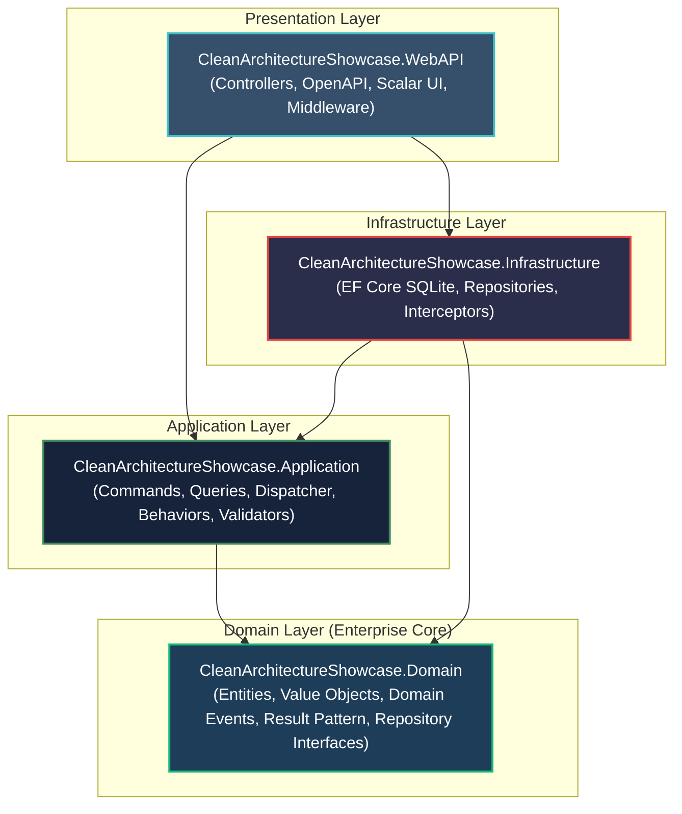
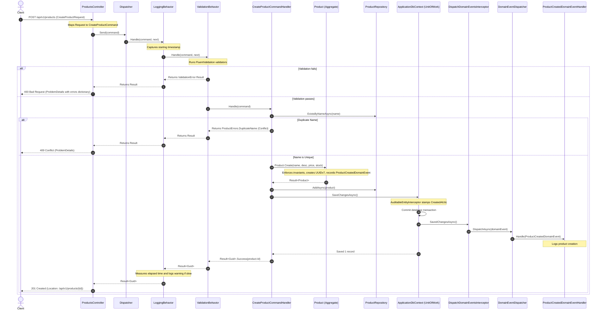

# Clean Architecture Showcase (.NET 10 & C# 14)

[](https://github.com/behnxm/CleanArchitectureShowcase)
[](LICENSE)
[](https://dotnet.microsoft.com/)

A production-grade reference implementation of **Clean Architecture** built on **.NET 10 (`net10.0`, LTS)** and **C# 14**.

I designed this repository to serve two purposes:
1. **My Public Technical Portfolio**: Demonstrating production-grade enterprise software architecture, SOLID design principles, automated testing pyramids, and defensive API design.
2. **My Personal Architectural Reference**: A clean baseline implementing a **hand-written, zero-dependency CQRS and pipeline engine** (an in-process mediator replacement) with pure C# and zero third-party licensing baggage.

---

## Quickstart

### Prerequisites
- [.NET 10 SDK (v10.0.400+)](https://dotnet.microsoft.com/download/dotnet/10.0)
- Git

### Run the API
```bash
# 1. Clone the repository
git clone https://github.com/behnxm/CleanArchitectureShowcase.git
cd CleanArchitectureShowcase

# 2. Run the Web API project (uses embedded SQLite by default; zero external database setup required)
dotnet run --project src/CleanArchitectureShowcase.WebAPI
```

Once running, navigate to:
- **Interactive Scalar API Documentation**: [`http://localhost:5000/scalar`](http://localhost:5000/scalar)
- **OpenAPI v1 Specification**: [`http://localhost:5000/openapi/v1.json`](http://localhost:5000/openapi/v1.json)
- **Liveness Health Check**: [`http://localhost:5000/health`](http://localhost:5000/health)
- **Readiness Health Check**: [`http://localhost:5000/health/ready`](http://localhost:5000/health/ready)

### Run Automated Tests
```bash
dotnet test
```

---

## Architectural Layers and the Dependency Rule

Clean Architecture isolates core enterprise business logic from frameworks, UI technologies, and databases. Dependencies point strictly inward.



---

## Folder-by-Folder Guide & Constraints

| Layer | Project | Responsibilities | What is FORBIDDEN in this layer |
|---|---|---|---|
| **Domain** | `CleanArchitectureShowcase.Domain` | Aggregate roots (`Product`), domain events (`ProductCreatedDomainEvent`), error records (`ProductErrors`), Result pattern (`Result`, `Result<T>`), repository interfaces (`IProductRepository`), and unit of work (`IUnitOfWork`). | **Zero NuGet packages**. No EF Core attributes, no FluentValidation, no ASP.NET references, no database concerns, no public property setters. |
| **Application** | `CleanArchitectureShowcase.Application` | Use-case orchestrators (commands, queries, handlers), in-process CQRS pipeline engine (`Dispatcher`), cross-cutting pipeline behaviors (`LoggingBehavior`, `ValidationBehavior`), read repository abstractions (`IProductReadRepository`), and contracts (`ProductResponse`, `PagedList<T>`). | No database contexts, no EF Core packages, no SQL queries, no HTTP/ASP.NET Core dependencies, no UI concerns. |
| **Infrastructure** | `CleanArchitectureShowcase.Infrastructure` | Database persistence (`ApplicationDbContext`), EF Core entity type configurations, SaveChanges interceptors (`AuditableEntityInterceptor`, `DispatchDomainEventsInterceptor`), write repository (`ProductRepository`), and read repository (`ProductReadRepository`). | No presentation controllers, no HTTP request models, no business rules that belong in aggregates. |
| **WebAPI** | `CleanArchitectureShowcase.WebAPI` | Presentation entry point and composition root. Exposes REST controllers (`ProductsController`), ProblemDetails error mapping, OpenAPI documentation, Scalar reference, and exception handling middleware. | No business logic, no EF Core DbContext calls directly inside controllers, no try/catch blocks in controller actions. |

---

## Design Patterns Catalogue

| Pattern | Implementation File | Architectural Purpose |
|---|---|---|
| **CQRS** | [`ICommand.cs`](src/CleanArchitectureShowcase.Application/Common/Messaging/ICommand.cs), [`IQuery.cs`](src/CleanArchitectureShowcase.Application/Common/Messaging/IQuery.cs) | Segregates state-mutating operations from read-only data queries. |
| **Mediator** | [`Dispatcher.cs`](src/CleanArchitectureShowcase.Application/Common/Messaging/Dispatcher.cs) | Decouples HTTP controllers from application use-case handlers. |
| **Decorator / Pipeline** | [`IPipelineBehavior.cs`](src/CleanArchitectureShowcase.Application/Common/Messaging/IPipelineBehavior.cs) | Applies cross-cutting concerns (logging, validation) around handler execution without modifying handler code. |
| **Chain of Responsibility** | [`Dispatcher.cs`](src/CleanArchitectureShowcase.Application/Common/Messaging/Dispatcher.cs) | Assembles behaviors dynamically via a right-to-left fold so that the first registered behavior is the outermost decorator. |
| **Repository** | [`ProductRepository.cs`](src/CleanArchitectureShowcase.Infrastructure/Persistence/Repositories/ProductRepository.cs), [`ProductReadRepository.cs`](src/CleanArchitectureShowcase.Infrastructure/Persistence/Repositories/ProductReadRepository.cs) | Mediates between the domain aggregate root and data mapping layers; provides separate write and read projections. |
| **Unit of Work** | [`IUnitOfWork.cs`](src/CleanArchitectureShowcase.Domain/Abstractions/IUnitOfWork.cs), [`ApplicationDbContext.cs`](src/CleanArchitectureShowcase.Infrastructure/Persistence/ApplicationDbContext.cs) | Coordinates transactional state persistence across multiple repository operations. |
| **Result Pattern** | [`Result.cs`](src/CleanArchitectureShowcase.Domain/Common/Result.cs), [`ResultExtensions.cs`](src/CleanArchitectureShowcase.WebAPI/Extensions/ResultExtensions.cs) | Replaces domain exceptions with explicit return types for deterministic error handling and ProblemDetails mapping. |
| **Factory Method** | [`Product.Create(...)`](src/CleanArchitectureShowcase.Domain/Entities/Product.cs) | Guarantees that entities cannot be instantiated in an invalid state and generates UUIDv7 keys. |
| **Interceptor** | [`AuditableEntityInterceptor.cs`](src/CleanArchitectureShowcase.Infrastructure/Persistence/Interceptors/AuditableEntityInterceptor.cs), [`DispatchDomainEventsInterceptor.cs`](src/CleanArchitectureShowcase.Infrastructure/Persistence/Interceptors/DispatchDomainEventsInterceptor.cs) | Decouples cross-cutting database lifecycle concerns (audit stamping and event dispatching) from the DbContext. |
| **Options Pattern** | [`LoggingBehaviorOptions.cs`](src/CleanArchitectureShowcase.Application/Common/Behaviors/LoggingBehaviorOptions.cs) | Strongly typed configuration binding for slow request logging thresholds. |

---

## SOLID Principles in Practice

| Principle | Concrete Application in Codebase |
|---|---|
| **Single Responsibility Principle (SRP)** | Each CQRS command handler (e.g. [`CreateProductCommandHandler.cs`](src/CleanArchitectureShowcase.Application/Features/Products/Commands/CreateProduct/CreateProductCommandHandler.cs)) executes exactly one use case. EF Core interceptors are split into two single-purpose classes: [`AuditableEntityInterceptor`](src/CleanArchitectureShowcase.Infrastructure/Persistence/Interceptors/AuditableEntityInterceptor.cs) (audit stamping) and [`DispatchDomainEventsInterceptor`](src/CleanArchitectureShowcase.Infrastructure/Persistence/Interceptors/DispatchDomainEventsInterceptor.cs) (event dispatching). |
| **Open/Closed Principle (OCP)** | Adding new cross-cutting behavior (e.g. metrics or caching) requires implementing a new [`IPipelineBehavior<TRequest, TResponse>`](src/CleanArchitectureShowcase.Application/Common/Messaging/IPipelineBehavior.cs) and registering it in DI, with zero changes to existing command or query handlers. |
| **Liskov Substitution Principle (LSP)** | [`Result<T>`](src/CleanArchitectureShowcase.Domain/Common/Result.cs) derives from `Result` without altering the invariant behavior of the base class. Any consumer expecting a `Result` can operate identically on a `Result<T>`. |
| **Interface Segregation Principle (ISP)** | Rather than a monolithic `IRepository<T>`, the domain defines a focused write repository [`IProductRepository`](src/CleanArchitectureShowcase.Domain/Abstractions/IProductRepository.cs) with only write methods, and the application defines [`IProductReadRepository`](src/CleanArchitectureShowcase.Application/Abstractions/IProductReadRepository.cs) for queries. |
| **Dependency Inversion Principle (DIP)** | High-level modules (Application) never depend on low-level modules (Infrastructure). Application declares abstractions (`IProductRepository`, `IProductReadRepository`, `IUnitOfWork`, `IDomainEventDispatcher`), and Infrastructure implements them. |

---

## Request Lifecycle: `POST /api/v1/products`

Here is what happens under the hood when a client submits a request to create a product:



---

## Why Not MediatR / AutoMapper / Moq / FluentAssertions?

The .NET ecosystem experienced major licensing and architectural shifts between 2023 and 2026. This repository reflects modern best practices and eliminates third-party licensing risks:

### 1. Why Not MediatR?
- **Licensing Shift**: Starting with version 13.0, MediatR transitioned from Apache-2.0 to a commercial license and a restricted Reciprocal Public License (RPL-1.5). While earlier 12.x versions remain Apache-2.0, the 12.x branch is frozen and no longer receives active feature enhancements.
- **Architectural Clarity**: In-process mediation is not complex. Implementing [`Dispatcher.cs`](src/CleanArchitectureShowcase.Application/Common/Messaging/Dispatcher.cs) in ~100 lines removes third-party lock-in and demonstrates how pipelines and cached delegates function without magic.

### 2. Why Not AutoMapper?
- **Project Maintenance**: AutoMapper is no longer undergoing major architectural development. Its creator has publicly advised moving to explicit code or compile-time generators.
- **Safety & Performance**: AutoMapper uses runtime reflection and string-based property mapping that can fail at runtime. Explicit extension methods ([`ProductMappingExtensions.cs`](src/CleanArchitectureShowcase.Application/Features/Products/Contracts/ProductMappingExtensions.cs)) provide compile-time safety, zero runtime reflection, and seamless debuggability.

### 3. Why Not Moq?
- **Ecosystem Trust**: In August 2023, Moq release 4.20 introduced `SponsorLink`, a closed-source dependency that silently exfiltrated hashed email addresses during builds to check sponsor status. While reverted after community pushback, the incident permanently damaged trust.
- **NSubstitute**: I use [`NSubstitute`](https://nsubstitute.github.io/) (BSD-3-Clause), which provides clean, type-safe, and transparent mocking without controversial telemetry.

### 4. Why Not FluentAssertions?
- **Licensing Shift**: FluentAssertions transitioned from Apache-2.0 in version 7.x to a proprietary, commercial license (via Xceed) in version 8.0+. Commercial users must pay license fees to consume version 8+.
- **Shouldly**: I use [`Shouldly`](https://github.com/shouldly/shouldly) (BSD-3-Clause), an open-source assertion framework that produces clear, readable assertion failure diffs with zero commercial restrictions.

---

## Mediator Architectural Comparison

| Dimension | MediatR (13+) | Hand-Written Dispatcher (This Repo) | Source-Generated Mediator (e.g. `martinothamar/Mediator`) |
|---|---|---|---|
| **License** | RPL-1.5 / Paid Commercial | **MIT (Zero risk, self-contained)** | MIT / Apache-2.0 |
| **Pipeline Resolution** | Dynamic reflection / Runtime delegate compiling | **Cached Invoker (`ConcurrentDictionary`)**; statically typed after first call | Compile-time Roslyn Source Generator |
| **Native AOT Compatibility** | Limited; requires manual runtime trimmer hints | Requires trimmer preservation or static registration | Native AOT compliant out of the box |
| **Maintenance Burden** | Upstream package dependency | Hand-maintained code (~120 LOC) | Upstream source generator dependency |
| **Complexity** | External black box | Transparent, direct, educational | Roslyn compiler generator |

---

## When Clean Architecture is Overkill

Clean Architecture is not a universal hammer. Using it for simple CRUD microservices introduces unnecessary indirection and friction.

### When to Avoid Clean Architecture:
- **Pure Data Ingestion & CRUD**: If an API simply reads and writes database rows with no complex domain rules or state machines, four layers, distinct DTOs, and mediator dispatches create bloat.
- **Short-Lived MVPs**: Rapid prototyping benefits from fewer abstraction boundaries.
- **Vertical Slice Alternative**: For many services, **Vertical Slice Architecture** is superior: organizing code by feature (e.g., `Features/CreateProduct/`) with Minimal APIs and direct EF Core queries cuts out repetitive mapping ceremonies while keeping each feature completely isolated.

### The Repository-over-EF-Core Debate:
Some architects argue that EF Core `DbSet` already implements the Repository pattern and `DbContext` implements Unit of Work, making a custom repository redundant.
In this codebase:
- The **Write-Side Repository** (`IProductRepository`) is valuable because it encapsulates aggregate persistence and enforces that domain logic cannot run arbitrary raw SQL or bypass entity invariants.
- The **Read-Side Repository** (`IProductReadRepository`) is valuable because it encapsulates optimized `AsNoTracking` queries and projection queries, preventing controllers from directly referencing EF Core.

---

## Deliberate Limitations & Future Extensions

This repository keeps the business domain deliberately trivial (Product Catalog CRUD) to focus on architectural excellence. By design, the following concerns are omitted to prevent bloated sample code:
1. **Authentication & Authorization**: No JWT or OAuth2 handlers. Security middleware should wrap the API in real enterprise deployments.
2. **Outbox Pattern**: Domain events are dispatched after transaction commit via EF interceptors (at-most-once delivery). Mission-critical systems requiring at-least-once transactional delivery should persist events to an Outbox table.
3. **Optimistic Concurrency**: RowVersion / concurrency tokens are omitted from the single Product entity.
4. **API Versioning Package**: Versioning is represented via standard URL path routing (`/api/v1/products`) rather than third-party packages (`Asp.Versioning.Mvc`).
